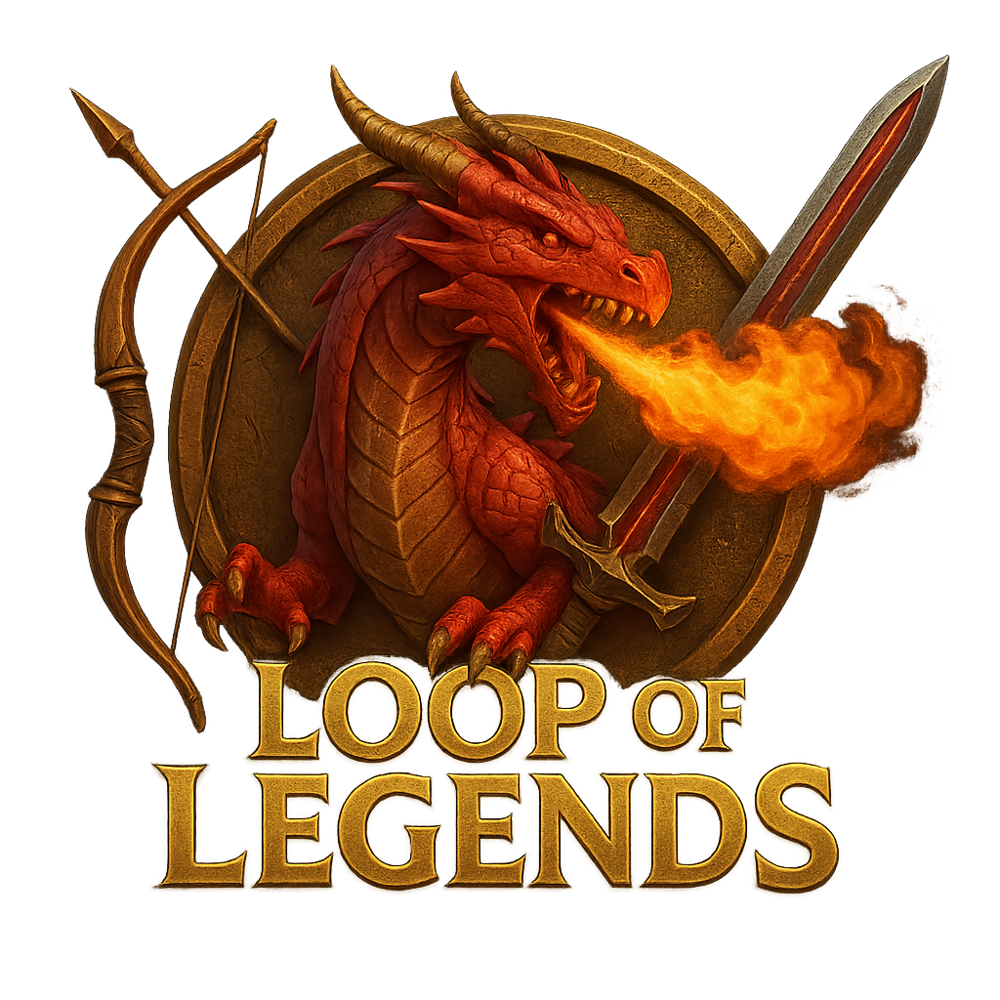

# ⚔️ Loop of Legends

<div align="center">

  

  ### *Step Into an Enchanted Realm of Lore, Magic, and Mythic Battles*

  [](https://www.php.net/)
  [](https://www.mysql.com/)
  [](https://getbootstrap.com/)
  [](https://git-lfs.com/)

</div>

---

## 📖 About the Project

**Loop of Legends** is an immersive fantasy gaming and multimedia web portal. Built with a rich dark-fantasy aesthetic, it invites users to explore a legendary universe filled with mythical kingdoms, powerful heroes, dark villains, interactive story episodes, and playable games.

The platform includes both an **interactive user-facing portal** and a **comprehensive Admin Dashboard** for dynamic content management (characters, episodes, games, reviews, and support inquiries).

---

## ✨ Features

### 🌐 User Portal
- **🏰 Mythic Kingdoms & Lore**: Explore legendary lands including the *Kingdom of Ember*, *Kingdom of Glacia*, *Kingdom of Syliva*, *Kingdom of Umbra*, and the *Samurai Realm*.
- **🗺️ Interactive Realm Map**: Visual map with clickable hotspots detailing realms, territories, and secrets.
- **🛡️ Character Archives**: Detailed profiles, lore backgrounds, factions, and statistics for legendary heroes and villains.
- **🎬 Episodes & Storylines**: Serialized lore chapters and episode releases.
- **🎮 Playable Mini-Games**: Built-in mini-game center with playable interactive experiences and release announcements.
- **🖼️ Media Gallery & Wallpapers**: High-resolution digital art, concept paintings, and cinematics.
- **🎵 Atmospheric Audio & SFX**: Integrated ambient soundscapes (battle ambiances, orchestral themes, nature sounds).
- **⭐ Community Reviews & Support**: User review submission system, trailer feedback, and direct contact/help desk forms.

### ⚙️ Admin Control Panel
- **🔐 Secure Authentication**: Protected login, registration, password reset, and session control.
- **📊 Interactive Dashboard**: High-level metrics and statistics of all website assets.
- **📝 Complete CRUD Operations**:
  - Add, edit, soft-delete, and restore **Characters**.
  - Manage **Episodes**, storylines, and release schedules.
  - Manage **Games** and playable links.
  - Curate and update the **Media Gallery**.
- **📬 Inquiries & Feedback Desk**: View incoming contact messages, moderate user reviews, and submit official replies.

---

## 🛠️ Tech Stack

- **Backend**: PHP (Object-Oriented & Procedural scripts)
- **Database**: MySQL / MariaDB (Relational schema with normalized tables)
- **Frontend**: HTML5, CSS3, JavaScript (ES6+), Bootstrap 5.3
- **Styling & Fonts**: Google Fonts (*Cinzel*, *Cinzel Decorative*), Bootstrap Icons
- **Media & Audio**: HTML5 Audio & Video APIs, ElevenLabs voice recordings, Git LFS for media assets
- **Local Server**: XAMPP / WampServer (Apache + MySQL)

---

## 📸 Screenshots

| Home Page | Interactive Map |
| :---: | :---: |
|  |  |

| Characters & Lore | Admin Dashboard |
| :---: | :---: |
|  |  |

---

## 🚀 Installation & Local Setup

### Prerequisites
- [XAMPP](https://www.apachefriends.org/) (with PHP 8.x and MySQL)
- [Git](https://git-scm.com/) & [Git LFS](https://git-lfs.com/)

### Step 1: Clone the Repository
```bash
git clone https://github.com/prathaaa8806/loop-of-legends.git
cd loop-of-legends
git lfs pull
```
*(Make sure to copy or clone the project folder into your XAMPP web directory, e.g., `C:\xampp\htdocs\loop-of-legends`)*

### Step 2: Database Setup
1. Start **Apache** and **MySQL** in your XAMPP Control Panel.
2. Open your browser and navigate to **[http://localhost/phpmyadmin](http://localhost/phpmyadmin)**.
3. Create a new database named:
   ```sql
   loop_of_legends
   ```
4. Click **Import** and select the complete database dump:
   ```
   Queries/loop_of_legends_complete.sql
   ```
   *(Alternatively, you can import individual tables from the `Queries/` directory)*.

### Step 3: Configure Database Connection (if needed)
The default database configuration is located in `db.php`:
```php
$host = "localhost";
$user = "root";
$pass = "";
$db   = "loop_of_legends";
```
Adjust credentials if your local MySQL has a root password configured.

### Step 4: Run the Application
Open your browser and visit:
```
http://localhost/loop-of-legends
```
To access the Admin Portal:
```
http://localhost/loop-of-legends/admin.php
```

---

## 📁 Project Directory Structure

```text
loop-of-legends/
├── Admin Panel SS/     # Admin panel screenshots and preview assets
├── Web SS/             # Website UI screenshots
├── Queries/            # Database schema & table dumps
│   ├── loop_of_legends_complete.sql  # Complete all-in-one database import
│   ├── characters.sql
│   ├── episodes.sql
│   ├── games.sql
│   └── ...
├── PPT/                # Presentation slides & training report documents
├── Report/             # Project documentation and reports
├── img/                # Visual assets, banners, trailers, character portraits
├── voice/              # Audio tracks, voiceovers, and ambient music
├── index.php           # Main landing / home page
├── about.php           # About page & lore introduction
├── characters.php      # Character roster and lore profiles
├── episode.php         # Episodes and storylines viewer
├── game.php            # Game showcase and downloads
├── gallery.php         # Digital media and wallpaper gallery
├── map.php             # Interactive world map
├── admin.php           # Admin login portal
├── dashboard.php       # Admin control panel
├── db.php              # Database connection handler
└── README.md           # Project documentation
```

---

## 👤 Author

Developed by **Pratha More**  
- GitHub: [@prathaaa8806](https://github.com/prathaaa8806)
